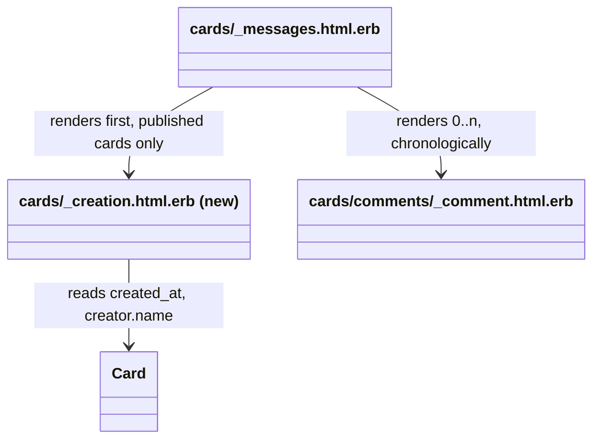
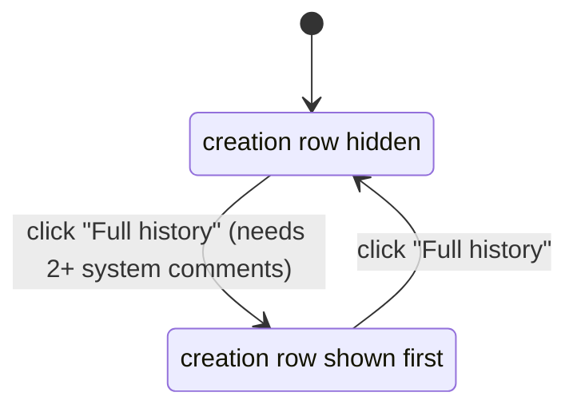

# Plan: Show the creation day in a card's full history

From `intent.md` (2026-11-06). Status: accepted.

**Target: Etienne's fork only.** Push only to `origin` (`eirvandelden/fizzy`). Open the pull request against `origin`. Never push to or open a pull request against `upstream` (`basecamp/fizzy`).

## Context

On a published card, `app/views/cards/_messages.html.erb` renders the card's comments in chronological order inside `messages_tag` (`app/helpers/messages_helper.rb`). That frame carries the `toggle-class` Stimulus controller, which toggles `comments--system-expanded` on it. System comments (creator is the system user) render through `app/views/cards/comments/_comment.html.erb` inside a `turbo-frame` with the class `comment-by-system`. `app/assets/stylesheets/comments.css` hides every `.comment-by-system` unless the frame is expanded, always shows the last one (`:nth-last-child(1 of .comment-by-system)`) with its "Full history" button, and hides that button when the same row is also the first system comment (`:nth-child(1 of .comment-by-system)`). So the button exists only for two or more system comments, and it is the only way to expand the history.

This change adds a view-only creation row at the top of the expanded history. It reads `card.creator` and `card.created_at`. Nothing is stored.

## Design

### Domain terms

No glossary exists in this repository. Terms used in this plan:

- **System comment**: a `Comment` whose creator is the account's system user, rendered inside `.comment-by-system`.
- **Full history**: the expanded state of a card's messages frame (`.comments--system-expanded`), toggled by the "Full history" button.
- **Collapsed view**: the default state, where only the last system comment shows.
- **Creation row** (new): a view-only row, "Created by <creator name>" plus the creation day, built from `card.created_at`. It is not a `Comment` and is never stored.

### Diagrams

### Signatures

Not affected: no Ruby class or method is added or changed. The new partial `app/views/cards/_creation.html.erb` takes one local, `card:`.

Not checked: Fizzy has no Steep or rbs_rails setup, and this change adds no Ruby method.

### Complexity

At most one extra query per card page: a primary-key lookup of the card's creator in `users`. `CardsController#set_card` does not preload `creator`. On a cold `cards/_container` fragment cache, `cards/display/common/_meta.html.erb` loads it first and the creation row adds zero queries. On a warm cache, `_meta` is skipped and the creation row loads it. The row reads no other association. The partial is O(1) and is not fragment-cached, because it holds only the creator name and a client-formatted time tag.

### Invariants

- The creation row is the first `.comment-by-system` child of the messages frame. Enforced by render order in `_messages.html.erb`.
- The creation row never counts as a system comment for the collapsed view or the button. Enforced by `:not(.comment-by-system--creation)` in the two `nth-*-child(… of …)` selectors in `comments.css`.
- The creation row shows only when the history is expanded. Enforced by the existing `.comment-by-system` / `.comments--system-expanded` rules.
- Drafts never render the creation row. Enforced by the existing `card.published?` guard in `_messages.html.erb` (and `CardsController#show` redirects drafts).

### Alternatives

1. **Chosen — reuse the system row with a modifier class.** The row carries `comment-by-system comment-by-system--creation`, so it gets the striped, centred, avatar-less look and the hide/expand rules for free. Two CSS selectors gain `:not(.comment-by-system--creation)` so the collapsed view and the button logic count exactly the same rows as today. Cost: two selector edits; zero queries; no duplicated CSS.
2. **Rejected — render only when `card.comments.by_system.many?`, no CSS edits.** It adds a COUNT query per card page, duplicates the CSS "two or more" rule in Ruby, and goes stale: when a broadcast adds the second system comment, the button appears but the creation row is missing until the next full render.
3. **Rejected — isolated `.comment-creation` class with its own CSS.** It leaves every existing selector untouched, and the row can stay hidden until `.comments--system-expanded` is present, because the existing system-comment selectors already gate the button. But it must repeat about 12 lines of the `.comment-by-system .comment` styling (centring, spacer, stripe gradient, expanded stripe colour), or widen each of those shared selectors to a second class. The system-row look can then drift between two copies.

## Design decisions

- The day uses `local_datetime_tag card.created_at, style: :date` (long date with year, for example "March 3, 2025"). The `:agoorweekday` style the other rows use has no year, which is wrong for old cards; the intent asks for the creation day, not a time.
- The body text is `<strong>Created</strong> by <name>`, matching the existing system comment wording ("<strong>Moved</strong> to “Done” by …"). The visible text reads "Created by Ana", as the acceptance criteria require. The name is escaped by ERB.
- The date is not a link: the creation row has no permalink, so it wraps the date in a `span.comment__permalink-title` for the same look as other rows.
- No conflict with `intent.md`'s `## Decisions`: the row shows only on expand, and nothing is stored.

## Integration points

- `messages_tag` / `toggle-class` Stimulus controller: unchanged; the row reacts to the same class toggle.
- Turbo: `cards/comments/create.turbo_stream.erb` inserts new comments `before [card, :new_comment]`, after the creation row, so the row stays first. Page-refresh morphs keep it through the stable id `dom_id(card, :creation)`.
- JSON API (`cards/_card.json.jbuilder`, comment jbuilders): untouched.

## Files that change

- `app/views/cards/_creation.html.erb` — new partial: `
" class="comment-by-system comment-by-system--creation">` > `div.comment.align-start.full-width` > `div.comment__content.flex.flex-column.flex-item-grow.full-width` > `div.comment__author.flex.align-center.gap-half` > `h3.font-weight-normal.txt-normal.flex-item-justify-start.min-width.overflow-ellipsis` > `span.comment__permalink-title` with `local_datetime_tag card.created_at, style: :date`; then `div.comment__body` with `<strong>Created</strong> by <%= card.creator.name %>`. No avatar, history button, edit link or reactions.
- `app/views/cards/_messages.html.erb` — inside `if card.published?`, render `cards/creation` before the comment collection.
- `app/assets/stylesheets/comments.css` — change `:nth-last-child(1 of .comment-by-system)` to `:nth-last-child(1 of .comment-by-system:not(.comment-by-system--creation))`, and `:nth-child(1 of .comment-by-system)` to `:nth-child(1 of .comment-by-system:not(.comment-by-system--creation))`.
- `test/system/card_history_test.rb` — new system test.
- `test/controllers/cards_controller_test.rb` — new show tests.
- `test/views/cards/creation_test.rb` — new partial tests.

## Order of work

1. Write the system test "full history shows the creation row first" in `test/system/card_history_test.rb`, run it (`bin/rails test test/system/card_history_test.rb`), watch it fail because "Created by David" never appears.
2. Write the partial tests in `test/views/cards/creation_test.rb` and the controller tests in `test/controllers/cards_controller_test.rb`, run them, watch them fail.
3. Add `app/views/cards/_creation.html.erb` and render it from `_messages.html.erb`. Run the partial and controller tests: green.
4. Edit the two selectors in `comments.css`. Run the system tests, including the collapse and single-system-comment cases: green.
5. Run `bin/rails test test/views/cards/creation_test.rb test/controllers/cards_controller_test.rb test/system/card_history_test.rb`, then the full suite (`bin/rails test`) and `PARALLEL_WORKERS=1 bin/rails test:system`, as `config/ci.rb` does.
6. Run `bin/rubocop` on the touched Ruby files, `bin/brakeman --quiet --no-pager --exit-on-warn --exit-on-error` and `bin/bundler-audit check --update`. The repository has no ERB or CSS linter.
7. Verify in the browser as a human would: open a card with several system comments, expand and collapse "Full history", and check the row on a card with one system comment. Record the evidence.

## Risks

- Selectors with `:not()` inside `:nth-child(… of …)` need a current browser (Chrome 111+, Firefox 113+, Safari 9+). The existing `of S` syntax already sets that bar.
- A card whose creator is the system user would read "Created by System". Rare; accepted.
- The creation row sits before user comments too, not only before the first move. That is chronologically correct: a card is created before any comment on it.
- Out of scope: a creation date in the collapsed view, a creation event or stored system comment, any JSON/API output, a glossary file.

## Proof

- Clicking "Full history" on a card shows "Created by Ana" with the creation day above the first move → `test/system/card_history_test.rb` `test "full history shows the creation row first"` (cards(:logo), creator David: before the click "Created by David" is not visible; after it, the text is visible and the creation row is the first visible `.comment-by-system`)
- A card with no other history has no "Full history" button and shows no creation row → `test/system/card_history_test.rb` `test "a card with one system comment shows no full history button and no creation row"` (cards(:layout)) and `test "a card with no system comments shows no creation row"` (cards(:buy_domain), which has no comments)
- Collapsing the history hides the creation row again → `test/system/card_history_test.rb` `test "collapsing the full history hides the creation row"`
- A card created before this change shows its creation row too → `test/controllers/cards_controller_test.rb` `test "show renders the creation row from the card's created_at"` (cards(:logo), a fixture card with no creation event or creation comment; asserts `time[data-local-time-target=date][datetime=?]` with `card.created_at.to_i` inside `#creation_card_…`, and the text "Created by David")
- Query count: the creation row adds at most one query, a lookup of the creator → `test/views/cards/creation_test.rb` `test "renders with one query when the creator is not loaded"` (`assert_queries_count(1) { render "cards/creation", card: Card.find(cards(:logo).id) }`) and `test "renders without queries once the creator is loaded"` (`assert_no_queries { … }` after `card.creator` is read)
- Invariant: the creation row is the first `.comment-by-system` and does not change the number of real system rows, enforced by render order in `_messages.html.erb` → `test/controllers/cards_controller_test.rb` `test "show renders the creation row before the system comments"` (first `.comment-by-system` has the creation id; `.comment-by-system:not(.comment-by-system--creation)` count equals the card's system comment count)
- Invariant: the button logic ignores the creation row, enforced by the `:not(.comment-by-system--creation)` selectors in `comments.css` → `test/system/card_history_test.rb` `test "a card with one system comment shows no full history button and no creation row"`
- Out of scope, JSON output unchanged: the partial renders only from the HTML messages view; no jbuilder file changes → check: `git diff --stat main -- '*.jbuilder'` is empty, and the existing JSON tests in `test/controllers/cards_controller_test.rb` stay green
- Invariant: drafts never render the creation row, enforced by the existing `card.published?` guard in `_messages.html.erb` and the draft redirect in `CardsController` → existing `test/controllers/cards_controller_test.rb` `test "show redirects to draft when card is drafted"`

Per changed file, the unit tests expected, named as behaviour:
- `app/views/cards/_creation.html.erb`: in `test/views/cards/creation_test.rb` (an `ActionView::TestCase`, like `test/helpers/application_helper_test.rb`): `renders "Created by" and the creator name`, `renders the creation day as a date time tag`, `escapes the creator name`, `renders with one query when the creator is not loaded`, `renders without queries once the creator is loaded`.
- `app/views/cards/_messages.html.erb`: `show renders the creation row from the card's created_at`, `show renders the creation row before the system comments`.
- `app/assets/stylesheets/comments.css`: covered by the system tests above; CSS has no unit tests.

Test setup: fixtures only, never mutated in a test. cards(:logo) (creator David, three system comments: button shown), cards(:layout) (creator David, one system comment: no button) and cards(:buy_domain) (creator David, no comments). The `escapes the creator name` test renders the partial with an unsaved `Card.new(creator: User.new(name: "<b>Ana</b>"), created_at: …)` and saves nothing. Sign in as an existing user with access, as `test/system/card_refresh_test.rb` does. No faked boundaries.

---
Domain skills applied: rails-ui, rails-testing, software-design, 37signals-style (STYLE.md).

## Critique

### Round 1 (codex exec -p terra)

- The zero-query claim is false on a warm `cards/_container` fragment cache, because `set_card` does not preload `creator` and `_meta` is then skipped → fixed (Complexity now states at most one extra creator lookup; the Proof adds a view test for one query with an unloaded creator and zero with a loaded one)
- The test setup mutates fixtures with `destroy_all` and `update_column` → fixed (the zero-history case uses the buy_domain fixture; the legacy-date case uses the logo fixture as stored; Test setup states fixtures are never mutated)
- The JSON proof cannot exercise the new partial, since JSON `show` renders Jbuilder → fixed (removed that test; the Proof line is now a check that no jbuilder file changes and existing JSON tests stay green)
- The rejected isolated-class alternative is described wrongly: it needs no `:has()` guard → fixed (alternative 3 rewritten; it is still rejected for duplicated or widened shared styling)
