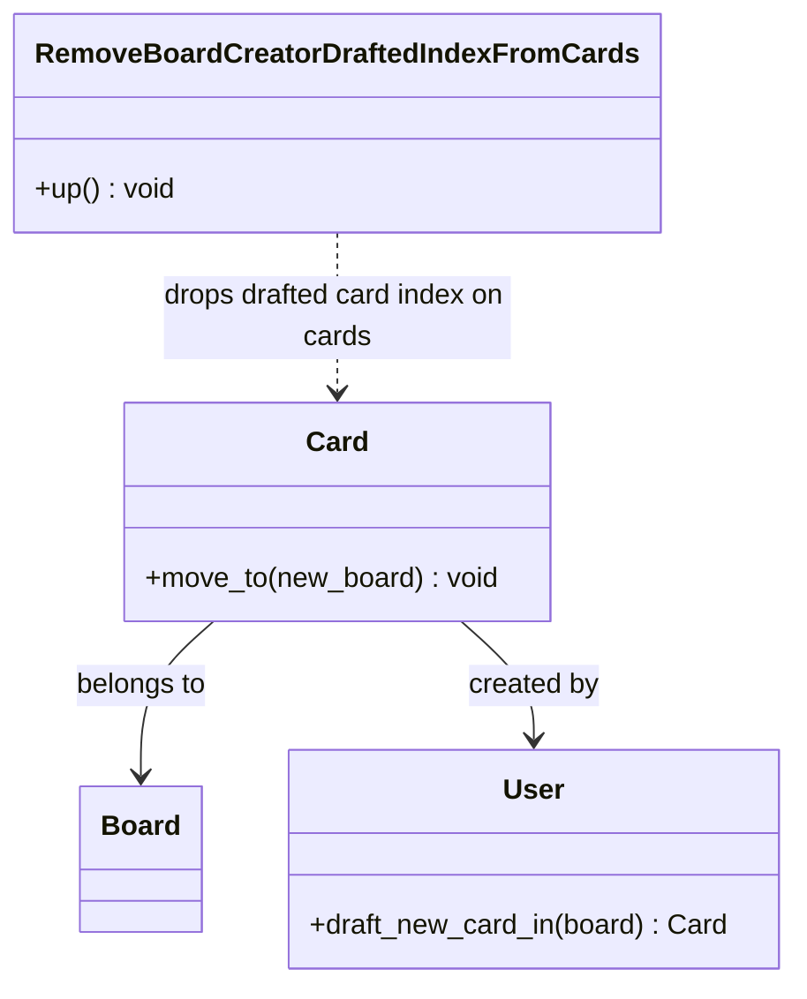
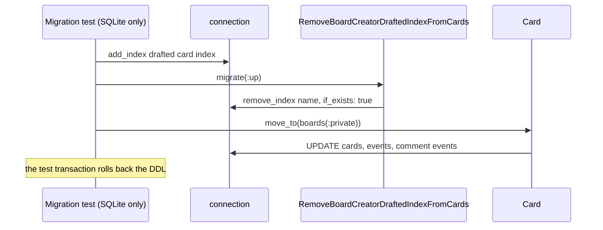

# Plan: Move a draft card between boards

From `intent.md` (2026-11-02). Status: accepted.

## Context

Production SQLite carries a drift index, `index_cards_on_board_creator_drafted`: `UNIQUE (board_id, creator_id) WHERE status = 'drafted'`. No migration and no committed schema contains it. The evidence is external: the production error, and the `db/schema_sqlite.rb` that the main checkout (not this worktree) dumped from a copy of the live database and left uncommitted. This worktree's schema files are clean. `Card#move_to` (`app/models/card.rb:74`) then raises `ActiveRecord::RecordNotUnique: UNIQUE constraint failed: cards.board_id, cards.creator_id` when the creator already has a draft on the target board. Upstream `basecamp/fizzy` has no such index. The fix is one migration that drops the index where it exists. Application code does not change.

## Design

### Domain terms

- **Draft**: a card with `status = 'drafted'` (`Card::Statuses`). Existing term.
- **Move**: `Card#move_to(board)`, which changes the board of a card. Existing term.
- **Drafted card index** (new): the production-only partial unique index `index_cards_on_board_creator_drafted` on `cards(board_id, creator_id) WHERE status = 'drafted'`.

The repository has no glossary file. The new term is not written to a glossary in this change (see Design decisions).

### Diagrams





ER: not affected. Columns and committed indexes do not change. Only the version line of both schema files changes.

### Signatures

`db/migrate/20261102120000_remove_board_creator_drafted_index_from_cards.rb` — drops the drafted card index where it exists.

```ruby
class RemoveBoardCreatorDraftedIndexFromCards < ActiveRecord::Migration[8.2]
  def up
    remove_index :cards, name: "index_cards_on_board_creator_drafted", if_exists: true
  end
end
```

No `down`: the inherited `Migration#down` does nothing, so a rollback succeeds and creates nothing. That matches the committed schema, which never had the index.

`Card`, `Cards::BoardsController`, `User::Accessor`: not affected.

Test class `RemoveBoardCreatorDraftedIndexFromCardsTest < ActiveSupport::TestCase` (new file `test/db/migrate/remove_board_creator_drafted_index_from_cards_test.rb`):

- Class-level `if ActiveRecord::Base.connection_db_config.adapter == "sqlite3"` block that defines the three index-present tests. It reads the config and opens no connection before the parallel fork. It does not use `Fizzy.db_adapter.sqlite?`, which reads only `DATABASE_ADAPTER` and is wrong in SaaS mode, where the connection is always MySQL.
- Private helpers:
  - `add_drafted_card_index` — `connection.add_index :cards, [ :board_id, :creator_id ], unique: true, where: "status = 'drafted'", name: "index_cards_on_board_creator_drafted"`.
  - `migrate_up` — finds the migration by class name in `connection_pool.migration_context.migrations`, fails the test when it is missing, and runs `migrate(:up)` inside `ActiveRecord::Migration.suppress_messages`. The lookup is lazy, so a missing migration fails only these tests, not the suite load.
  - `drafted_card_index?` — `connection.index_name_exists?(:cards, "index_cards_on_board_creator_drafted")`.
  - `kevin_drafts_on_writebook_and_private` — `users(:kevin).draft_new_card_in(boards(:writebook))` and `users(:kevin).draft_new_card_in(boards(:private))`, the production path.

Departure: the migration carries no `#:` comment, because the repository's rubocop (Layout/LeadingCommentSpace) rejects it and upstream style has none.

Not checked: Fizzy has no Steep or rbs_rails setup; the `#:` comments document the types only.

### Complexity

- Migration, index absent: a fixed number of schema queries to list the indexes on `cards`. No DDL.
- Migration, index present: the same schema queries plus one `DROP INDEX`. Cost does not depend on the row count of `cards`.
- `Card#move_to` and its `after_update` board-change callbacks: unchanged. Writes to `cards` get slightly cheaper without the index.
- No query-count claim, so no query-count test.

### Invariants

- I1. After the migration, `cards` has no index named `index_cards_on_board_creator_drafted`. Enforced by the migration.
- I2. The migration runs no DDL and does not raise on a database without the index. Enforced by `if_exists: true`. On MySQL this also means no implicit commit inside the test transaction.
- I3. One creator may hold more than one draft on one board after a move. Enforced by the absence of any constraint in the committed `db/schema.rb` and `db/schema_sqlite.rb`, as upstream.
- I4. The test setup reproduces the production failure: with the index present and no migration, a move raises `RecordNotUnique` on `cards.board_id, cards.creator_id`. Enforced by a characterization test.
- I5. Every DDL statement a test runs rolls back with that test's transaction. Enforced by defining the index-present tests only on `sqlite3`, where DDL is transactional and each parallel worker has its own database file.
- I6. Both schema files carry version `2026_11_02_120000`, equal to the new migration. Otherwise `maintain_test_schema!` and `db:setup` in CI raise `PendingMigrationError`.

### Alternatives

- A. Minimal: one migration test file; the adapter guard sits inside the index-creating helper, so every test runs on both adapters. Rejected: on MySQL the removal and post-migration tests would pass without the index and prove nothing, and the characterization test, which expects `RecordNotUnique`, would fail. So all index-present tests must be defined only on SQLite.
- B. Maximal: a shared `DraftedCardIndexTestHelper` module in `test/test_helpers`, a `partial_index_test` class macro, raw-SQL index creation, a request-level regression test with the index and seven tests across three files. Rejected: too much test machinery for a one-line migration; only one test class needs the helpers.
- C. Chosen: one migration test file with private helpers and an adapter-scoped block for the three index-present tests, plus two request-level tests in the existing controller test that run on both adapters. It keeps the characterization test from B and the small footprint from A.
- Also rejected: `change` with `column:`, `unique:` and `where:`. Its inverse is `add_index ... if_not_exists`, and on MySQL that drops `where:` and creates a full unique index on rollback. `change` with `name:` only raises `IrreversibleMigration` on rollback. An explicit `down` that recreates the index puts back a defect no commit ever introduced.
- Also rejected (intent Decisions): reworking `Card#move_to` instead of dropping the index.

## Design decisions

- `up` only, no `down` — see Alternatives.
- The index-present tests are defined only on `sqlite3`. They are not skipped on MySQL; they do not exist there, because MySQL cannot hold a partial index and its DDL commits the test transaction. The test count differs between the SQLite and MySQL CI jobs.
- The guard reads `ActiveRecord::Base.connection_db_config.adapter`, not `Fizzy.db_adapter.sqlite?`, so it is correct in SaaS mode.
- Edit the schema version line by hand in `db/schema.rb` and `db/schema_sqlite.rb`. Do not regenerate either file: a local dump can pull uncommitted drift (`db/schema_sqlite.rb`, `db/cable_schema.rb`) into the commit, against playbook rule 21 and intent's constraints.
- No glossary write in this change: the stage that handed this plan over restricts it to `plan.md`. The term "drafted card index" stays deferred.
- No conflict with intent's `## Decisions`: the index is removed, `move_to` is untouched, the other fork-only changes stay out.

## Integration points

- Production SQLite database at tasks.vandelden.family: the migration runs on the next deploy, which Etienne approves and runs himself.
- CI (`.github/workflows/test.yml`): runs the suite on SQLite and MySQL, in OSS and SaaS modes. The adapter-scoped block must hold in all four.
- `User::Accessor#draft_new_card_in` is used by the tests as is. Its fork-only retry is out of scope.

## Files that change

- `db/migrate/20261102120000_remove_board_creator_drafted_index_from_cards.rb` — new migration, drops the drafted card index where it exists.
- `db/schema.rb` — version line only: `2026_08_28_120000` → `2026_11_02_120000`.
- `db/schema_sqlite.rb` — version line only, same change.
- `test/db/migrate/remove_board_creator_drafted_index_from_cards_test.rb` — new; the first migration test in the repository. The default `test/**/*_test.rb` glob picks it up.
- `test/controllers/cards/boards_controller_test.rb` — two new request-level tests.

## Order of work

1. Write `test/db/migrate/remove_board_creator_drafted_index_from_cards_test.rb` with all four tests. Run it on SQLite (`bin/rails test test/db/migrate/remove_board_creator_drafted_index_from_cards_test.rb`). Watch "a draft moves to a board where its creator already has a draft once the index is gone" and "removes the drafted card index when present" fail because the migration is missing. Watch the characterization test pass with `RecordNotUnique` on `cards.board_id, cards.creator_id`, the production error.
2. Write the two controller tests. Run them; they pass on the committed schema, which has no index. They lock in the upstream behaviour.
3. Commit the tests.
4. Add the migration. Bump the version line in both schema files by hand. Check that `git diff db/schema.rb db/schema_sqlite.rb` shows exactly two changed lines.
5. Run the migration test file again; all four pass.
6. Run the migration test file and the controller test file under MySQL (`DATABASE_ADAPTER=mysql`) when a local MySQL is available; only "does nothing when the drafted card index is absent" and the controller tests run there. If no local MySQL is available, rely on CI and say so.
7. Commit the migration and schema version bump. Do not run `bin/rails db:migrate` against the development database: it would rewrite `db/schema_sqlite.rb` from local state, and the migration tests already cover both database states.
8. Run the full suite, `bin/rubocop`, `bin/brakeman` and `bin/bundler-audit` (where present). Re-read the full diff.

## Risks

- A schema version typo breaks CI with `PendingMigrationError`. The CI test job catches it.
- A reviewer may "simplify" the guard to `Fizzy.db_adapter.sqlite?`. That would run SQLite DDL on a MySQL connection in SaaS CI. The design decision above records why not.
- `DROP INDEX` in a SQLite transaction can raise `SQLITE_LOCKED` if a statement on that connection is still open. It would show as a test error, not a false pass.
- A rollback does not restore the drafted card index. Production cannot get the old constraint back with `db:rollback`. Intended.
- Nothing in the database stops two drafts for one creator on one board. Upstream accepts this; the intent puts concurrent-create guards out of scope.

Out of scope: `User::Accessor#draft_new_card_in` retry and `resync_cards_count_for`; `Card#assign_number`; any guard against concurrent draft creation; deploying the migration; finding out who created the index; the uncommitted drift in `db/schema_sqlite.rb` and `db/cable_schema.rb`.

## Proof

- A user with a draft on board A and a draft on board B moves the draft from A to B; the move succeeds and both drafts exist on board B → `test/db/migrate/remove_board_creator_drafted_index_from_cards_test.rb` `a draft moves to a board where its creator already has a draft once the index is gone` (regression test, SQLite, fails before the migration exists) and `test/controllers/cards/boards_controller_test.rb` `update moves a draft to a board where its creator has another draft` (both adapters).
- A user with one draft on board A moves it to board B, which has no draft of theirs; the move succeeds → `test/controllers/cards/boards_controller_test.rb` `update moves a draft to a board without a draft of its creator`.
- Running the migration on a database without the index does not raise → `test/db/migrate/remove_board_creator_drafted_index_from_cards_test.rb` `does nothing when the drafted card index is absent` (both adapters).
- Running the migration on a database with the index removes it → `test/db/migrate/remove_board_creator_drafted_index_from_cards_test.rb` `removes the drafted card index when present` (SQLite).
- Invariant: the migration runs no DDL on a database without the index, enforced by `if_exists: true` → `test/db/migrate/remove_board_creator_drafted_index_from_cards_test.rb` `does nothing when the drafted card index is absent` (asserts the index list of `cards` does not change and no `DROP INDEX` query runs, via `assert_no_queries_match(/DROP INDEX/i, include_schema: true)`).
- Invariant: the test setup reproduces the production failure, enforced by the characterization test → `test/db/migrate/remove_board_creator_drafted_index_from_cards_test.rb` `the drafted card index rejects moving a draft onto a board with another draft of its creator` (asserts `RecordNotUnique` matching `cards.board_id, cards.creator_id`).
- Invariant: both schema files carry the new version → check: `grep -n "2026_11_02_120000" db/schema.rb db/schema_sqlite.rb` shows both, and the full suite boots without `PendingMigrationError`.

Per changed file, the unit tests expected, named as behaviour:
- `db/migrate/20261102120000_remove_board_creator_drafted_index_from_cards.rb`: `does nothing when the drafted card index is absent`, `removes the drafted card index when present`, `the drafted card index rejects moving a draft onto a board with another draft of its creator`, `a draft moves to a board where its creator already has a draft once the index is gone`.
- `test/controllers/cards/boards_controller_test.rb`: `update moves a draft to a board where its creator has another draft`, `update moves a draft to a board without a draft of its creator`.

Test setup: existing fixtures only. `users(:kevin)` (signed in by the controller test's setup) has access to `boards(:writebook)` and `boards(:private)`. Drafts come from `users(:kevin).draft_new_card_in(board)`. The only drafted fixture, `cards(:unfinished_thoughts)`, has no duplicate pair, so creating the index over the fixtures succeeds. The index-present tests create the index with `add_index` inside the test transaction; SQLite rolls it back.

---
Domain skills applied: rails-architecture, rails-testing, software-design, 37signals-style (STYLE.md).

## Critique

### Round 1 (codex -p terra)

- The plan places the drafted card index in local uncommitted schema drift, but this worktree's schema files and upstream lack it; state it as external production evidence and preflight the target database → fixed (Context now says the evidence is the production error and the main checkout's uncommitted dump, and that this worktree is clean; the production preflight part is dismissed because `if_exists: true` makes the migration safe either way and deploying is out of scope)
- The Complexity line understates `Card#move_to` as one update and two `update_all` calls, ignoring its `after_update` board-change callbacks → fixed (the line now says the method and its callbacks are unchanged, with no write count)
- Alternative A's rejection says every index-present test would pass vacuously on MySQL, but the characterization test would fail there → fixed (the rejection now says the removal and post-migration tests go vacuous and the characterization test fails, so all three must be SQLite-only)
- The manual `bin/rails db:migrate` step on a development database copy names no copy or isolated configuration → fixed (step removed; the migration tests cover both states, and step 7 now forbids running the migration against the development database)
