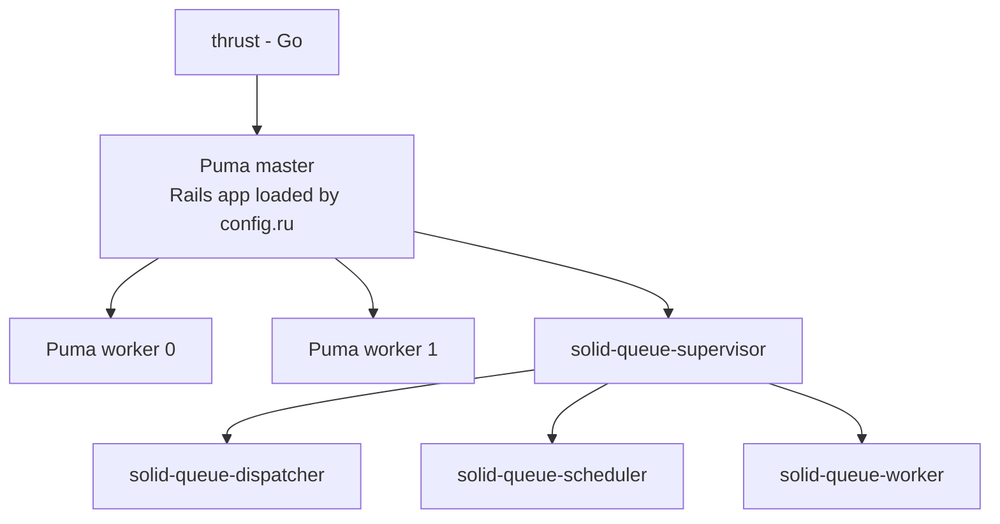
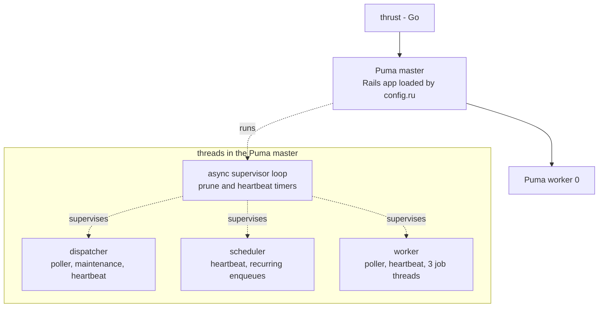

# Plan: Run Solid Queue in async mode inside Puma

From `intent.md` (2026-10-26). Status: accepted.

## Design

### Domain terms

No domain terms change. The change uses Solid Queue's own terms: **fork mode** (the supervisor forks one process per dispatcher, scheduler and worker) and **async mode** (the supervisor runs them as threads in its own process). The repository has no `GLOSSARY.md`, and no term was agreed in this change, so the glossary stays absent.

### Diagrams

Before: the Puma master forks one Puma worker per `WEB_CONCURRENCY` (2), and after boot forks one Solid Queue supervisor, which forks a dispatcher, a scheduler and `JOB_CONCURRENCY` (1) workers.



After: one Puma worker; the supervisor, dispatcher, scheduler and worker are threads in the Puma master.



Four Solid Queue processes become zero; two Puma workers become one.

Boot sequence after the change:

```mermaid
sequenceDiagram
  participant R as bin/rails server
  participant M as Puma master
  participant W as Puma worker 0
  participant SQ as Solid Queue (threads in master)
  R->>R: build config.ru (require config/environment)
  R->>M: Puma launcher run (cluster, workers 1, preload_app false)
  M->>W: fork worker 0 (worker loads nothing new; app already in memory)
  M->>SQ: after_booted: SolidQueue::Supervisor.start(mode: :async, standalone: false)
  SQ->>SQ: register processes, load recurring tasks, poll queue DB
  M->>SQ: after_stopped: supervisor.stop
  M->>SQ: before_restart: stop, then start again
```

### Signatures

Not affected: no Ruby class or method changes. `config/puma.rb` gains one call to the existing Puma DSL method `solid_queue_mode`, which `solid_queue` 1.7.0 defines in `lib/puma/plugin/solid_queue.rb`.

### Complexity

Not affected per request: Puma serves requests from the worker as before, with `threads 1, 1`. Background work moves from four forked processes (supervisor, dispatcher, scheduler, worker) into threads of the Puma master: the supervisor loop and its timers, the dispatcher, the scheduler, and the worker with its poller and pool of 3 job threads. One Puma worker serves all requests instead of two; at 2 to 5 users per app this is the accepted trade (intent: memory over throughput).

Queue-database connections in the master share one `SolidQueue::Record` pool. Threads that check out a connection: the supervisor's prune and heartbeat timers, the dispatcher's poller, maintenance timer and heartbeat, the worker's poller, heartbeat and 3 job threads, the scheduler's heartbeat and its recurring enqueues. Solid Queue sizes only one worker: its pool check asks for the worker's 3 job threads + 2 (poller and heartbeat), which is exactly the current pool of 5, with nothing left for the dispatcher, scheduler and supervisor threads that share the pool in async mode. Rails holds a connection only per query or transaction, and overflow waits up to the 5 s `checkout_timeout` instead of failing at once. The value 10 is intentional headroom over those 5 plus the other threads, as intent decides; it is not a measured peak. `RAILS_MAX_THREADS: 10` raises the pool of every SQLite database (primary, cable, cache, queue) from 5 to 10. Pools are a cap and open connections lazily, so the Puma worker opens no extra connections.

Idle query load is unchanged from fork mode with `JOB_CONCURRENCY=1`: the worker polls every 0.1 s and the dispatcher every 1 s. Async mode forces `processes` to 1 (`solid_queue` `configuration.rb:191`), so `JOB_CONCURRENCY` has no effect.

### Invariants

- Production starts no `solid-queue-*` process. Enforced by `solid_queue_mode :async` in `config/puma.rb`, inside the existing `unless` block. Checked by the production-like boot in `## Proof`.
- Local environments, SaaS and `SOLID_QUEUE_IN_PUMA=false` still load no Solid Queue plugin. Enforced by the unchanged `unless` guard. Proven by the existing `test/puma_config_test.rb`.
- `solid_queue_mode` comes after `plugin :solid_queue`. Puma's DSL `plugin` requires `puma/plugin/solid_queue` at evaluation time, and that file defines `solid_queue_mode`; called first it raises `NoMethodError`.
- The Rails app is loaded in the Puma master although `preload_app` defaults to false with one worker (Puma 8 `set_conditional_default_options`). The container runs `bin/rails server`; `Rackup::Server#start` builds `config.ru` (and so `config/environment`) before `server.run`, and `Rack::Handler::Puma` hands Puma the built app. Checked by the boot in `## Proof`: a job runs in the master.
- No Solid Queue thread exists when Puma forks its first worker. Puma fires `after_booted` after the workers boot and after `before_fork { Process.warmup }`. A later replacement fork copies only the forking thread; Active Record's fork tracker and sqlite3 2.x fork safety discard the inherited connections (expect one sqlite3 warning line per replacement).
- The queue pool in production is 10. Enforced by `RAILS_MAX_THREADS: 10` in `deploy.yml`, read by `config/database.sqlite.yml`. Checked in the boot: `SolidQueue::Record.connection_pool.size` is 10.
- One async supervisor runs per container while it runs, and none after SIGTERM. Checked in the boot: one `SolidQueue::Process` row of kind `Supervisor(async)` while running, and zero process rows after shutdown. It does not hold during a Puma phased restart (SIGUSR1): `before_restart` starts a supervisor and `after_booted` starts a second one. Kamal replaces containers and never phased-restarts, so no code enforces it.

### Alternatives

1. **`solid_queue_mode :async` in `config/puma.rb`, `WEB_CONCURRENCY: 1` and `RAILS_MAX_THREADS: 10` in `deploy.yml`.** Chosen. One line of fork-local code, the rest in deploy settings, as intent decides.
2. **Mode set only through an environment variable in `deploy.yml`.** Rejected. The Puma plugin reads only `launcher.options[:solid_queue_mode]`; `SOLID_QUEUE_SUPERVISOR_MODE` affects `bin/jobs` only. It would need code in `puma.rb` to read the variable, which is a larger diff than the fixed call.
3. **Raise the queue pool in `config/database.sqlite.yml` instead of `RAILS_MAX_THREADS`.** Rejected by intent's `## Decisions`: a second fork-local diff against upstream, against the approach of commit 441978c88.
4. **`solid_queue_mode ENV.fetch("SOLID_QUEUE_MODE", "fork")` plus a `deploy.yml` key.** Rejected. It fits "settings live in `deploy.yml`" a little better, but a rollback still needs a deploy, it invents an environment variable, and intent fixes the literal `:async` in scope.
5. **A watchdog thread in `config/puma.rb` that stops Puma when the async supervisor dies.** Rejected for this change: more fork-local code, and intent did not ask for it. Named as a follow-up in `## Risks`.

## Design decisions

- No new automated test. `config/puma.rb` and `config/deploy.yml` are configuration, and playbook rule 3 says configuration has no tests. The proof is the production-like boot, recorded as evidence, and the existing `test/puma_config_test.rb` stays green.
- The production-like boot runs `bin/rails server` directly, without `bin/thrust`. Thruster is a Go proxy, not a Ruby process, so it does not change the process count the criteria check. It also runs with `DISABLE_SSL=true`, so `/up` over plain HTTP answers 200 instead of the 301 that `force_ssl` gives; production sits behind kamal-proxy with the same effect from `forward_headers`.
- The scratch SQLite path is the worktree's own `storage/` directory, which git ignores and which holds no other data. `config/database.sqlite.yml` hardcodes `storage/production*.sqlite3`, and the intent forbids changing it. Order of work step 1 proves those files are absent before the run, and step 6 deletes only the files the run created.
- `Appkit::SessionExpiryJob` does not exist in this repository (`grep -rn SessionExpiry app config lib` finds nothing). The recurring-task criterion is "where present", so the check covers the tasks of `config/recurring.yml` `production` only.
- No conflict with intent's `## Decisions`.

## Integration points

- Puma 8.0.2 cluster mode and its `after_booted`, `after_stopped`, `before_restart` hooks, through the `solid_queue` 1.7.0 Puma plugin.
- Solid Queue 1.7.0 async supervisor, `config/queue.yml` (unchanged; `processes` is ignored in async mode) and `config/recurring.yml` (unchanged).
- The queue SQLite database `storage/production_queue.sqlite3` and the pool from `config/database.sqlite.yml` (unchanged file; `RAILS_MAX_THREADS` sets its value).
- Kamal `config/deploy.yml` `env.clear`. Etienne deploys; no agent runs kamal.
- Upstream basecamp/fizzy merges: `config/puma.rb` already diverges; the new line sits inside the fork-local `unless` block.

## Files that change

- `config/puma.rb` — add `solid_queue_mode :async` on the line directly after `plugin :solid_queue`, inside the existing `unless` block. Extend the comment above the block by one line that says why async (memory, not throughput). Approved under playbook rule 13 in intent.
- `config/deploy.yml` — in `env.clear`, change `WEB_CONCURRENCY: 2` to `WEB_CONCURRENCY: 1`, and add `RAILS_MAX_THREADS: 10` with a short trailing comment (queue pool for the async Solid Queue threads). Keep `JOB_CONCURRENCY: 1`. Approved under playbook rule 13 in intent.
- `docs/changes/solid-queue-async-in-puma/verification.md` — new; the recorded evidence of the production-like boot (before and after).

Nothing else changes: not `config/queue.yml`, `config/recurring.yml`, `config/database*.yml`, the `Dockerfile`, `bin/*`, or any SaaS file.

## Order of work

No acceptance criterion needs a new test (configuration only), so the work starts with a baseline boot, then the change, then the checks.

1. Guard the scratch path. Run `ls storage/production*.sqlite3* 2>/dev/null`. It must print nothing; if any file exists, stop and report it, because it is data this plan did not create. Record the empty listing in `verification.md`.
2. Baseline boot, before any edit, to record what fork mode looks like. Set `BEFORE="RAILS_ENV=production SECRET_KEY_BASE_DUMMY=1 SAAS=false DISABLE_SSL=true SOLID_QUEUE_IN_PUMA=true WEB_CONCURRENCY=2 JOB_CONCURRENCY=1 PIDFILE=tmp/pids/verify.pid"`, and prefix every command of this step with `env $BEFORE`:
   1. `env $BEFORE bin/rails db:prepare` — creates `storage/production*.sqlite3` in the worktree.
   2. `env $BEFORE bin/rails server -p 3999 > tmp/verify-before.log 2>&1 &`; wait until `curl -s -o /dev/null -w '%{http_code}' http://127.0.0.1:3999/up` prints `200`.
   3. Record the process tree of this server only: `M=$(cat tmp/pids/verify.pid)`, then `ps -o pid,ppid,rss,command -A | awk -v m=$M 'NR==1 || $1==m || $2==m'` for the master and its children, and the same `awk` once per child pid for the grandchildren (the Solid Queue supervisor's forks).
   4. Stop with `kill -TERM $M`, `wait`, and confirm `ps -o pid= -p $M` and the step 2.3 listing are empty.
3. Edit `config/puma.rb`: add `solid_queue_mode :async` after `plugin :solid_queue`, and the one comment line.
4. Edit `config/deploy.yml`: `WEB_CONCURRENCY: 1`, add `RAILS_MAX_THREADS: 10`.
5. After boot. Set `AFTER="RAILS_ENV=production SECRET_KEY_BASE_DUMMY=1 SAAS=false DISABLE_SSL=true SOLID_QUEUE_IN_PUMA=true WEB_CONCURRENCY=1 JOB_CONCURRENCY=1 RAILS_MAX_THREADS=10 PIDFILE=tmp/pids/verify.pid"` (the `deploy.yml` values), and prefix every command of this step, server and runners alike, with `env $AFTER`:
   1. `env $AFTER bin/rails server -p 3999 > tmp/verify-after.log 2>&1 &`; wait until the `curl` of step 2.2 prints `200`. Record the status.
   2. `M=$(cat tmp/pids/verify.pid)`; list the master, its children and grandchildren as in step 2.3. Expect the master `puma 8.0.2 (tcp://...)`, one child `puma: cluster worker 0`, no grandchild, and no `solid-queue-supervisor`, `-dispatcher`, `-scheduler` or `-worker`.
   3. Enqueue a job from a separate process and keep its id: `JOB=$(env $AFTER bin/rails runner 'print DeleteUnusedTagsJob.perform_later.job_id')`.
   4. Within 10 seconds, find the `Performed DeleteUnusedTagsJob (Job ID: $JOB)` line in `tmp/verify-after.log`. The `#<pid>` in its `Logger::Formatter` prefix must equal `$M`. Then `env $AFTER JOB=$JOB bin/rails runner 'p SolidQueue::Job.find_by!(active_job_id: ENV["JOB"]).finished_at'` prints a time, not nil.
   5. `env $AFTER bin/rails runner 'p SolidQueue::Process.pluck(:kind, :pid)'`: exactly one `Supervisor(async)` row, one `Dispatcher`, one `Scheduler`, one `Worker`, and every pid equals `$M`.
   6. `env $AFTER bin/rails runner 'p SolidQueue::RecurringTask.pluck(:key).sort'` prints the 10 keys of `config/recurring.yml` `production` with `SAAS=false`: `auto_postpone_all_due`, `cleanup_exports`, `cleanup_imports`, `cleanup_magic_links`, `cleanup_transfers`, `cleanup_webhook_deliveries`, `clear_solid_queue_finished_jobs`, `delete_unused_tags`, `deliver_bundled_notifications`, `incineration`.
   7. `env $AFTER bin/rails runner 'p SolidQueue::Record.connection_pool.size'` prints `10`.
   8. Record the RSS of the master and the worker next to the baseline numbers.
   9. Stop with `kill -TERM $M`, then `wait` for the server job and record its exit status (expect 0). Confirm the log shows Solid Queue stopping, no `ThreadError` and no immediate termination, and that the step 5.2 listing is empty.
   10. `env $AFTER bin/rails runner 'p SolidQueue::Process.count'` prints `0`: shutdown deregistered every process.
   11. Search `tmp/verify-after.log` for `ConnectionTimeoutError`, `Exception` and `Error`; record any hit.
6. Write all outputs into `verification.md`: commands, process trees before and after, the job log line with its pid, the process and recurring task lists, the pool size, `/up` status, RSS numbers, exit status. Then delete only the files this run created: the `storage/production*.sqlite3*` files that step 1 proved absent, `tmp/verify-before.log`, `tmp/verify-after.log` and `tmp/pids/verify.pid`.
7. Run `bin/rails test test/puma_config_test.rb`, then the full `bin/rails test`, then `bin/rails test:system` with `PARALLEL_WORKERS=1`.
8. Run `bin/rubocop config/puma.rb`, then `bin/rubocop -f simple`. Check `config/deploy.yml` parses: `ruby -ryaml -rerb -e 'YAML.safe_load(ERB.new(File.read("config/deploy.yml")).result)'`.
9. Run `bin/brakeman --quiet --no-pager --exit-on-warn --exit-on-error` and `bin/bundler-audit check --update`.
10. Re-read the full diff; it holds only the two config files and `verification.md` (plus the change folder).
11. Commit in small steps: one commit for `config/puma.rb`, one for `config/deploy.yml`, one for `verification.md`.

## Risks

- **A job in the master runs with no process isolation.** A job that leaks memory or blocks the GVL now affects the Puma master, and a crash of the master takes requests down too. Accepted by intent (memory over throughput and isolation, against the solid_queue README's fork recommendation).
- **A dead async supervisor goes unnoticed.** A dead dispatcher, worker or scheduler thread is replaced within about 1 s by `AsyncSupervisor`. But if the supervisor thread itself dies, it shuts its threads down, and Puma keeps serving with no jobs and `/up` still 200. In fork mode the plugin's `monitor_solid_queue` stops Puma instead. Mitigation: none in scope; a watchdog is a possible follow-up.
- **A slow shutdown exits the container.** When a job outlives `SolidQueue.shutdown_timeout` (5 s) at SIGTERM, Solid Queue calls `exit!` in the Puma master. The interrupted job is failed with `ProcessPrunedError` after the next boot, not retried. Fork mode has the same timeout path, in a separate process.
- **A native crash or OOM in a job kills HTTP serving.** Image jobs run libvips in the master. Docker's restart policy restarts the container. A replacement Puma worker forked after vips ran in the master could hang in a later vips call; this needs a worker crash first, so it is unlikely.
- **A phased restart or hot restart doubles or orphans supervisors.** See `### Invariants`. Kamal does not use either; `tmp/restart.txt` is not touched in production.
- **Puma replaces a dead worker while Solid Queue threads run in the master.** The fork copies only the forking thread; Active Record's fork tracker discards inherited connection pools in the child. The worker never runs jobs. Low risk.
- **`RAILS_MAX_THREADS` widens every SQLite pool, not only the queue's.** Pools open connections lazily, so the worker and unused pools stay small. If 10 is still too low, the log shows `ActiveRecord::ConnectionTimeoutError` from a Solid Queue thread.
- **Upstream merge drops the line.** `config/puma.rb` is a fork-local diff. A merge that resolves the `unless` block in favour of upstream loses `solid_queue_mode :async` silently and brings back the forked processes. Rejected guard: a new test, because configuration has no tests.
- **Local boot differs from the container.** It runs on macOS, without Thruster or kamal-proxy, and with `DISABLE_SSL=true`. The process tree under Puma and the Solid Queue behaviour are the same code paths.

## Proof

- Production-like boot shows one Puma master, one Puma worker, and no `solid-queue-supervisor`, `-dispatcher`, `-scheduler` or `-worker` → check: Order of work step 5.2, process tree in `verification.md`.
- An enqueued job runs in that boot, in the Puma master → check: Order of work steps 5.3 to 5.5, log line pid and `SolidQueue::Process` pids in `verification.md`.
- The recurring tasks of `config/recurring.yml` load → check: Order of work step 5.6, `SolidQueue::RecurringTask` keys in `verification.md` (`Appkit::SessionExpiryJob` is not present in this repository).
- `/up` returns 200 → check: Order of work step 5.1, `curl` status in `verification.md`.
- The full test suite and every linter stay green → check: `bin/rails test`, `PARALLEL_WORKERS=1 bin/rails test:system`, `bin/rubocop -f simple`, `bin/brakeman --quiet --no-pager --exit-on-warn --exit-on-error`, `bin/bundler-audit check --update`.
- Invariant: local environments load no Solid Queue plugin, enforced by the `unless` guard in `config/puma.rb` → `test/puma_config_test.rb` `no local environment runs Solid Queue inside Puma` (existing).
- Invariant: production starts no `solid-queue-*` process, enforced by `solid_queue_mode :async` in `config/puma.rb` → check: Order of work step 5.2.
- Invariant: the queue pool is 10, enforced by `RAILS_MAX_THREADS: 10` in `config/deploy.yml` → check: Order of work step 5.7.
- Invariant: one async supervisor per container, enforced by the plugin's `after_booted` hook firing once → check: Order of work step 5.5.
- Invariant: SIGTERM stops Solid Queue and Puma cleanly → check: Order of work steps 5.9 and 5.10.
- Query count: not affected; no request path changes.

Per changed file, the unit tests expected:
- `config/puma.rb`: none (configuration).
- `config/deploy.yml`: none (configuration).

Test setup: no fixtures. The boot uses the worktree's `storage/` as a scratch database location and removes the production SQLite files afterwards. It never reads `.env`, `config/master.key` or `.kamal/secrets`; `SECRET_KEY_BASE_DUMMY=1` replaces the secret key base.

## Out of scope

- Deploying, and any kamal command.
- Removing `JOB_CONCURRENCY`.
- `WEB_CONCURRENCY=0` (single mode).
- Changes to `config/queue.yml`, `config/recurring.yml`, `config/database*.yml`, the `Dockerfile` or the container image.
- SaaS mode.
- A watchdog that stops Puma when the async supervisor dies.

---
Domain skills applied: rails-ops, software-design, diagrams, glossary (no terms to write), rails-testing (configuration has no tests).

## Critique

### Round 1 (Codex, terra)

- The after-change commands do not carry the after-change environment: the server omits it and the runners keep `WEB_CONCURRENCY=2` without `RAILS_MAX_THREADS` → fixed (separate `BEFORE` and `AFTER` variables; every server and runner command of step 5 runs under `env $AFTER`)
- The job query uses a literal `"<id>"`, so `find_by` returns nil → fixed (step 5.3 captures the id in `JOB`; step 5.4 passes it through `ENV["JOB"]` to `find_by!`)
- The recurring-task check expects 11 keys, but production without SaaS has 10 → fixed (step 5.6 names the 10 keys)
- A global `ps` grep can match unrelated Puma or Solid Queue processes on the machine → fixed (steps 2.3 and 5.2 list only the pid-file master, its children and grandchildren)
- The supervisor invariant wrongly claims a supervisor after SIGTERM → fixed (one supervisor while running, zero process rows after shutdown; new step 5.10)
- The diagrams and complexity text say three forked processes, but fork mode has four Solid Queue processes and async mode adds a supervisor loop and a job thread pool → fixed (after diagram shows each thread group; complexity text names the four processes)
- The connection estimates of 17 and 8 have no source-backed derivation → fixed (complexity text now gives the gem's own sizing of 5 and presents 10 as intentional headroom from intent)
- The cleanup glob can delete persisted ignored SQLite data → fixed (step 1 proves no production SQLite file exists before the run and stops otherwise; step 6 deletes only files the run created)
